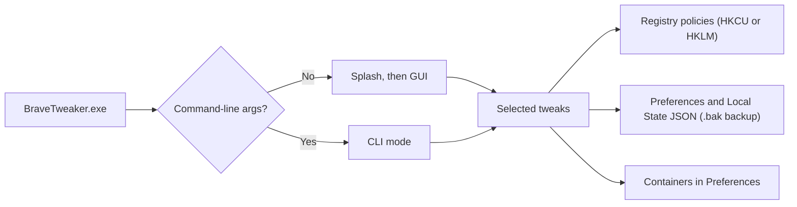

<div align="center">


# BraveTweaker

Windows GUI and CLI that applies 37 Brave Browser tweaks through registry policies and profile `Preferences` edits.


<br /><br />


<br /><br />

[Features](#features) • [Screenshots](#screenshots) • [How it works](#how-it-works) • [Installation](#installation) • [Usage](#usage) • [Configuration](#configuration) • [Troubleshooting](#troubleshooting)

</div>

## About

BraveTweaker is a single `BraveTweaker.exe` built with the `csc.exe` compiler that ships with Windows (WinForms, no external SDK). It writes Brave/Chromium policies to the registry (`HKCU` or `HKLM`) and patches the `Preferences` and `Local State` JSON files under `%LOCALAPPDATA%\BraveSoftware` for settings that have no policy. The executable's manifest requests administrator elevation.

## Features

- **37 tweaks in 3 categories** — Brave Bloat & UI (15), Prompts & Behavior (15), Privacy & Telemetry (7), each with an icon and an `ACTIVE` badge when already applied.
- **Presets** — `recommended`, `ui`, `prompts`, `privacy`, `all` (plus `none` in the GUI). Only `Disable Tor Windows` is unchecked in `recommended`.
- **Tab Containers page** — reads existing Brave containers, adds new ones (name, color, icon) or loads presets (Personal, Work, Banking, Shopping, Social); only creates containers that do not already exist.
- **Backup and revert** — backs up edited files with the `.brave-tweaker.bak` suffix and restores them on revert, which also removes the policies.
- **`.reg` export** — writes the policies of a selected preset to a `.reg` file.
- **Headless CLI** — `--apply`, `--revert`, `--status`, `--export-reg`, `--preset`, `--user`, `--machine`, `--close-brave`.
- **Filter box and log view** in the GUI, plus an `Auto-close Brave` option.

### Included tweaks

| Category | Tweaks |
| --- | --- |
| Brave Bloat & UI | Rewards, "Show sidebar" button, Wallet, VPN, AI features (Leo and Chromium GenAI), News, Talk, sponsored New Tab images, Tor windows, Wayback Machine prompts, full URLs in address bar, Downloads button pinned, tab groups hidden in bookmarks bar, Ultra dark theme, Manifest V2 and uBlock Origin |
| Prompts & Behavior | Password, credit card and address save offers, translation offers, notification and geolocation prompts, "Set as default browser" prompt, background mode, shopping and price tracking, "Close all tabs?" popup, start with New Tab page, full screen reminder, Energy Saver off, Google as search engine, Brave auto-update off |
| Privacy & Telemetry | Brave P3A and stats ping, Chromium metrics and feedback, WebRTC IP leak prevention, network prediction and preloading, Shields aggressive tracker/ad blocking, diagnostic reports off, Shields HTTPS strict upgrade |

## Screenshots

<!-- Screenshot not captured: the app manifest requires administrator elevation (UAC prompt), so it cannot be launched silently. -->

## How it works



Preferences edits are skipped while Brave is running (the log prints a warning); use `--close-brave` or the `Auto-close Brave` option.

## Installation

Download or clone the repo and run `BraveTweaker.exe`, or rebuild it:

```powershell
.\build.ps1
```

`build.ps1` requires `C:\Windows\Microsoft.NET\Framework64\v4.0.30319\csc.exe` and embeds `BraveTweaker.ico`, `BraveTweaker.png` and `app.manifest` when present.

## Usage

### GUI

Run `BraveTweaker.exe` with no arguments.

### CLI

```powershell
# Apply the recommended preset
.\BraveTweaker.exe --apply --close-brave

# Apply every tweak machine-wide (Administrator)
.\BraveTweaker.exe --apply --preset all --machine --close-brave

# Export a .reg file
.\BraveTweaker.exe --export-reg .\BraveTweaks.reg --preset recommended

# Show which tweaks are active
.\BraveTweaker.exe --status

# Remove policies and restore backups
.\BraveTweaker.exe --revert --close-brave
```

| Option | Meaning |
| --- | --- |
| `--preset <recommended\|ui\|prompts\|privacy\|all>` | Preset to apply or export (default `recommended`) |
| `--user` / `--hkcu` | Write policies to Current User |
| `--machine` / `--hklm` | Write policies to Local Machine (Administrator) |
| `--close-brave` | Close Brave before editing `Preferences` |

If neither scope flag is given, the CLI uses machine scope when running as Administrator and user scope otherwise.

## Configuration

There is no config file. Behavior is controlled by the selected tweaks/preset and the scope flags above.

## Troubleshooting

- **Preference-based tweaks do not apply** — Brave was running. Close it and re-apply, or pass `--close-brave`.
- **Undo changes** — run `--revert` or use the revert action in the GUI; it restores the `.brave-tweaker.bak` files.
- **Tweaks show as inactive in Brave** — check `brave://policy` after restarting the browser.
